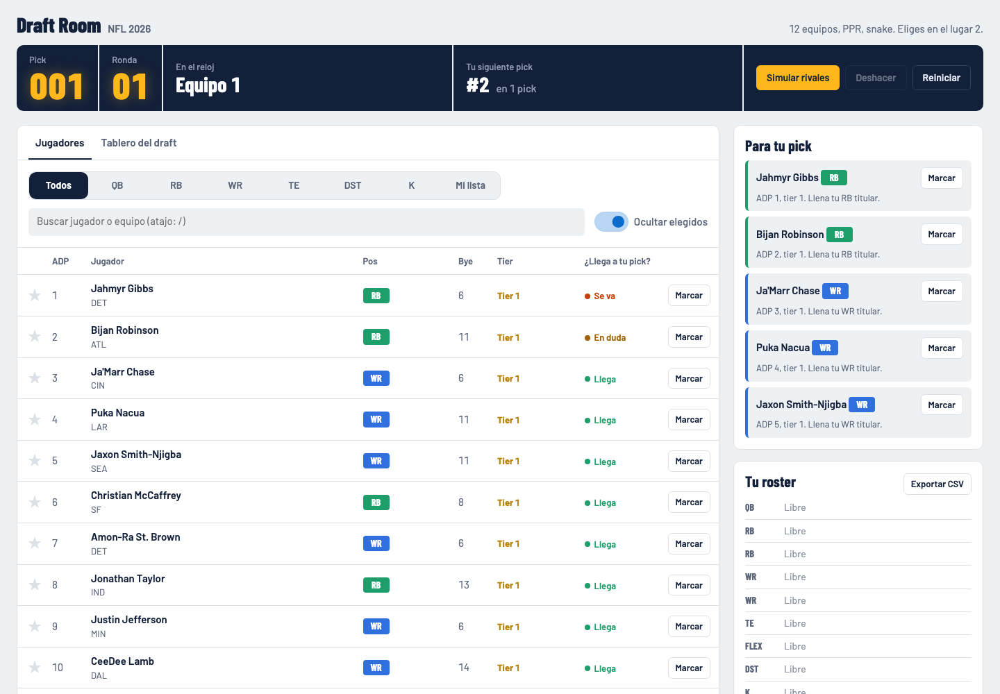

# Draft Room 2026

Asistente para seguir en vivo un draft de fantasy football de la NFL (temporada 2026-2027) y decidir cada pick.

Está configurado para una liga de **12 equipos, PPR, snake draft**, con roster de QB, 2 RB, 2 WR, TE, FLEX, DST, K y 7 de banca, eligiendo en el **lugar 2**.



## Cómo usarlo

1. Abre `index.html` en tu navegador (no necesita instalación ni servidor).
2. Durante tu draft real (ESPN, Yahoo, Sleeper, etc.), cada vez que alguien elige a un jugador, búscalo y presiona **Marcar**. El marcador avanza solo siguiendo el orden snake.
3. Cuando el marcador se pone verde es tu turno: revisa **Para tu pick** y presiona **Elegir**.
4. Para practicar sin un draft real, usa **Simular rivales**: los otros 11 equipos eligen solos hasta que te toque.

El progreso se guarda en tu navegador, así que puedes recargar la página sin perder el draft.

## Qué hace

| Función | Para qué sirve |
| --- | --- |
| Rankings PPR 2026 | Consenso de ~200 jugadores más defensas y kickers, con tier y bye week |
| Marcador de pick | Pick, ronda, equipo en turno y cuántos picks faltan para el tuyo |
| Para tu pick | Top 5 sugerencias según valor, lo que le falta a tu roster, tiers por agotarse y byes |
| ¿Llega a tu pick? | Estima si un jugador seguirá disponible en tu siguiente turno |
| Quedan por tier | Cuántos QB, RB, WR y TE quedan en cada tier, para detectar cuándo se acaba una posición |
| Simular rivales | Los rivales eligen por ADP con algo de azar y reglas de roster realistas |
| Mi lista | Marca con estrella a los jugadores que quieres seguir |
| Tablero del draft | Vista de las 16 rondas por equipo |
| Exportar CSV | Descarga tu roster final |

Atajos: `/` para buscar, `Ctrl+Z` (o `Cmd+Z`) para deshacer el último pick.

## Estructura

```
index.html        Estructura de la página
css/styles.css    Estilos y componentes
js/data.js        Rankings, defensas, kickers y bye weeks 2026
js/app.js         Lógica del draft, sugerencias y simulación
docs/             Captura para este README
```

## Flujo de trabajo en Git

El proyecto se desarrolló con ramas que se integraron a `main`:

- `main`: versión estable.
- `feature/rediseno-ui`: separación en archivos y rediseño de la interfaz.
- `feature/simulacion-rivales`: simulación, disponibilidad, escasez por tier, lista y exportar.
- `docs/readme`: esta documentación.

## Fuentes y créditos

- Rankings PPR de consenso: FantasyPros, NBC Sports (Rotoworld) y ESPN, agosto de 2026.
- Tiers de defensas: FantasyPros. Bye weeks: calendario oficial NFL 2026.
- Componentes adaptados de [Uiverse.io](https://uiverse.io) (licencia MIT): selector deslizante de Yaya12085, switch e input de búsqueda de alexruix.
- Tipografía: Barlow y Barlow Condensed (Google Fonts).

Los rankings son de pretemporada; pueden cambiar por lesiones o noticias.
